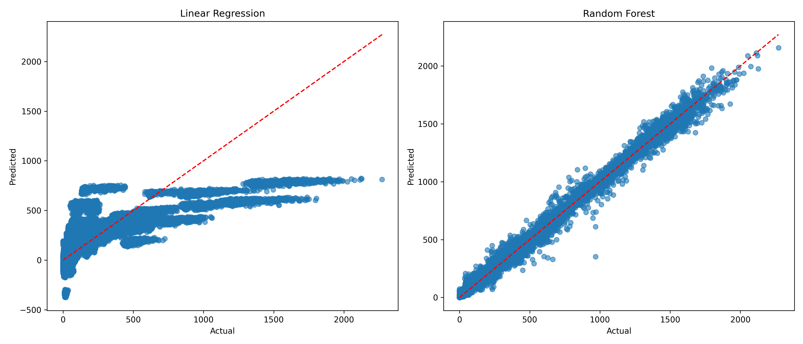

# Building Energy Consumption Prediction

## Overview

This project explores the prediction of building energy consumption using machine learning models.

The objective is to compare Linear Regression and Random Forest Regression using building characteristics, weather observations, and time-related features.

## Dataset

The project uses the ASHRAE Great Energy Predictor III dataset, which includes building metadata, historical meter readings, and weather data.

Dataset source: [ASHRAE - Great Energy Predictor III (Kaggle)](https://www.kaggle.com/competitions/ashrae-energy-prediction)

## Technologies

- Python
- Pandas
- Scikit-learn
- Matplotlib

## Project Workflow

1. Data loading and merging
2. Data cleaning and preprocessing
3. Feature engineering
4. One-hot encoding of categorical features
5. Training and testing data split
6. Training Linear Regression and Random Forest models
7. Model evaluation using R², MAE, and RMSE
8. Visualization of predictions

## Model Comparison

The following scatter plots compare actual and predicted meter readings for both models.

### Observations

**Linear Regression:** The model struggles with high consumption values and tends to underestimate them.

**Random Forest:** Predictions are much closer to the actual values, showing better performance in the current random train-test split.

## Evaluation Metrics

The models are evaluated using:

- R² Score
- Mean Absolute Error (MAE)
- Root Mean Squared Error (RMSE)

